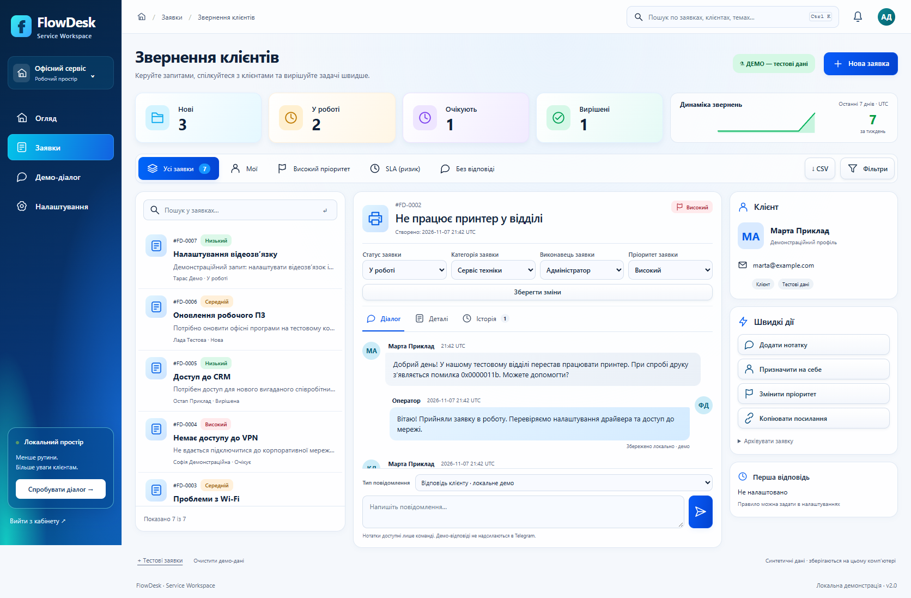
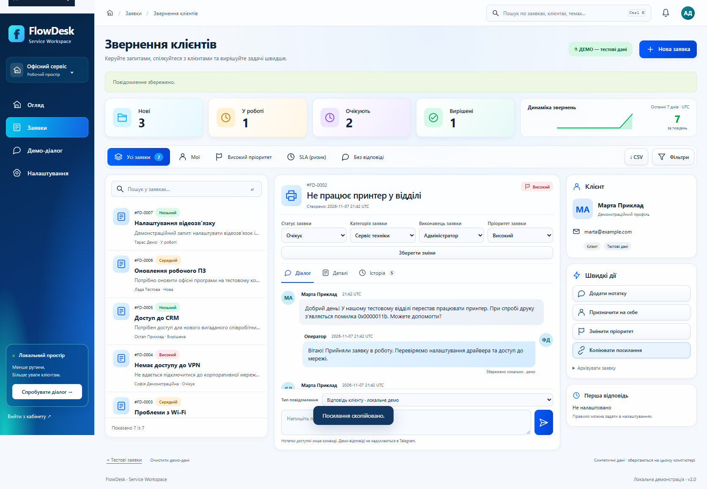

# FlowDesk — Service Workspace v2

Локальная система обработки обращений для небольшой сервисной команды. Украинский интерфейс, сервер FastAPI, SQLite, защищённый кабинет и отдельный Telegram-адаптер. Светлый рабочий экран: список заявок → переписка → клиент и быстрые действия. Проект доработан на существующем стеке, без переписывания базы и диалога.

## Запуск на Windows

В подготовленной папке Python и библиотеки уже установлены:

```powershell
cd D:\proek\FLOWDESK_BOT
powershell -ExecutionPolicy Bypass -File .\scripts\start.ps1
```

Откройте **http://127.0.0.1:8000/admin**. Пароль администратора находится в локальном `.env`, поле `FLOWDESK_ADMIN_PASSWORD`. Не отправляйте этот файл или пароль в чат. Демо-диалог: **http://127.0.0.1:8000/demo**. Остановка сервера — `Ctrl+C`. Если порт занят, добавьте `-Port 8001`.

Для чистой установки Windows 10/11 x64:

```powershell
powershell -ExecutionPolicy Bypass -File .\scripts\setup.ps1 -Dev
powershell -ExecutionPolicy Bypass -File .\scripts\start.ps1
```

Установщик размещает Python и библиотеки в `.runtime`; глобальные Node.js, Python и Docker не нужны. Первоначальная установка требует интернета, локальное демо — нет. Фронтенд не требует сборки, внешних шрифтов или CDN.

При первом запуске v2 выполняется транзакционная миграция: существующие заявки, ID, контакты, заметки и источники сохраняются. Старый статус `closed` остаётся доступен как «Закрита». Для резервной копии остановите веб-сервер и бот, затем скопируйте всю папку `data` в закрытое место. Не копируйте один SQLite-файл во время записи. Восстановление резервной копии отдельно не тестировалось.

## Что работает

- Создание через пошаговый `/demo` и административную форму; серверная валидация и защита повторной отправки.
- Статусы «Нова», «У роботі», «Очікує», «Вирішена», «Закрита»; приоритет, категория, исполнитель.
- KPI из активных записей SQLite, график количества за семь дней, обзор по статусам и приоритетам за период, последние изменения.
- Поиск по ID, теме, имени, контакту и описанию; совместные фильтры по статусу, категории, приоритету, исполнителю, датам, отсутствию ответа, риску SLA и архиву. Сортировка по обновлению, созданию или приоритету. Постраничный список по 25.
- Хронологическая переписка, локальные демо-ответы и отдельные внутренние заметки. Клиентский `/demo` не показывает заметки команды. Заметки не попадают в очередь Telegram.
- История с автором, временем, старым и новым значением. Повтор неизменённого сохранения не добавляет событие.
- «Призначити на себе», выбор приоритета, копирование прямой ссылки, архив и восстановление с подтверждением.
- Проверка версии записи предотвращает перезапись чужих изменений. При конфликте форма остаётся на экране; откройте актуальную карточку перед повторным сохранением.
- Асинхронные формы показывают загрузку, успех и ошибки. Черновик сообщения сохраняется в памяти вкладки при переходах между заявками и при сетевой ошибке. Закрытие/перезагрузка с несохранённым текстом требует подтверждения браузера. После закрытия вкладки черновик не сохраняется.
- Рабочий экран обновляется каждые 20 секунд, когда вкладка видима и пользователь не редактирует форму. Созданная в другой вкладке заявка появляется автоматически. Данные хранятся на сервере, не в localStorage.
- На телефоне список и карточка — отдельные состояния с возвратом назад; работают прямые ссылки и история браузера. `Ctrl+K` переводит фокус в поиск. Основные формы доступны без JavaScript.
- CSV: UTF-8 с BOM, экранирование, защита формульных ячеек, явная зона UTC; экспорт учитывает фильтры и включает тему, приоритет, исполнителя и время обновления. Переписка не включается в CSV.

«+ Тестові заявки» добавляет шесть синтетических примеров из `TEST_DATA/requests.json`, в том числе сохранённую демонстрационную переписку. Повтор не создаёт дубликаты и не перезаписывает существующие примеры. Поэтому уже загруженный набор v1 не изменится автоматически. Можно добавить новую заявку вручную; очищать старое демо следует только при отсутствии нужных данных.

«Очистити демо-дані» требует ввода `ВИДАЛИТИ` и прав администратора. Она удаляет демо-заявки, их сообщения и события, включая архив. Настоящие Telegram-заявки сохраняются. Для обратимой операции используйте архив.

## Доступ и SLA

В одном пространстве предусмотрены два общих аккаунта: администратор и оператор. Для оператора задайте необязательный `FLOWDESK_OPERATOR_PASSWORD` в `.env`: отдельная фраза от 12 символов. Оба аккаунта видят все заявки пространства; только администратор загружает/очищает демо и сохраняет настройки. Индивидуальные пользователи, несколько пространств и персональный аудит сотрудников не реализованы. Автор в истории — роль аккаунта.

Пароли проверяются через scrypt с солью; серверные сессии используют случайные токены, в БД хранятся их SHA-256. Смена пароля отзывает соответствующие сессии. Cookie: HttpOnly, SameSite=Strict; для локального HTTP Secure выключен. Изменения защищены CSRF, текст экранируется Jinja2, SQL параметризован, действует CSP. После пяти неверных входов — ограничение на 15 минут. Публичный демо-диалог ограничивает повторы и частоту по сессии; это не полноценная защита публичного сервиса от ботов.

В «Налаштування» задаётся **0–168 часов до первого ответа**, поддержка **24/7**, отображение времени и фильтрация — **UTC**. Ноль выключает SLA; без правила нет метки просрочки. Внутренние заметки, очередь и неподтверждённая отправка не считаются ответом. Локально сохранённый демо-ответ или подтверждённый ответ Telegram останавливает счётчик. Завершённые заявки исключены из риска. Новое правило применяется к существующим незавершённым заявкам; рабочий календарь и праздники не поддерживаются.

## Telegram: отдельно и только после настройки

Реальный бот в ходе разработки **не подключался**. Демо-диалог работает без API; пункт «СИМУЛЯЦІЯ · вхідне Telegram» в переписке создаёт только локальное сообщение в демо-заявке. На экране реальные Telegram-заявки обозначены своим источником, локальное сохранение не выдаётся за доставку.

Для реального подключения самостоятельно:

1. Создайте собственного бота и сохраните токен только в `.env` как `TELEGRAM_BOT_TOKEN`.
2. Установите необязательный транспорт:

   ```powershell
   powershell -ExecutionPolicy Bypass -File .\scripts\setup.ps1 -Telegram
   ```

3. Запустите отдельный процесс:

   ```powershell
   powershell -ExecutionPolicy Bypass -File .\scripts\start.ps1 -Mode telegram
   ```

4. В личном чате с ботом отправьте `/start`, заполните и подтвердите заявку. Последующие текстовые сообщения попадут в последнюю незавершённую заявку этого чата. `/start` начинает новую, `/cancel` отменяет ввод. Группы и вложения не поддерживаются.
5. Для ответов из кабинета явно включите `TELEGRAM_REPLIES_ENABLED=true` и перезапустите **оба** процесса. До включения отправка ответа реальному Telegram-клиенту блокируется; внутренняя заметка доступна.

Используется **polling**, публичный HTTPS для него не нужен. При обнаружении действующего webhook процесс останавливается; отключить webhook нужно самостоятельно. Не запускайте два polling-процесса для одного токена. Для веб-кабинета публичный HTTPS необходим при размещении в интернете.

Входящие Telegram-сообщения дедуплицируются по чату и ID сообщения в той же транзакции, что запись заявки/сообщения. Ответы хранятся в SQLite-очереди: «У черзі», «Доставка не підтверджена», «Доставлено» или ошибка. После сбоя отправка автоматически не повторяется, чтобы не отправить клиенту копию. Сначала проверьте чат и процесс бота; если процесс завершился после фактической отправки, состояние может остаться неподтверждённым. Автоматические уведомления о смене статуса и повторная доставка подтверждения входящего сообщения не реализованы.

Необязательные уведомления администратору остаются выключенными по умолчанию. Для включения нужны `TELEGRAM_ADMIN_CHAT_ID`, команда `/verify_admin` из соответствующего личного чата и `TELEGRAM_ADMIN_CONFIRMED=true`. Проверка привязана к токену бота и чату. Уведомление содержит только номер заявки.

## Структура

```text
flowdesk/
  web.py                HTTP, сессии, вход, CSRF, CSV
  storage.py            SQLite, выборки, синтетические данные
  migrations.py         транзакционная миграция v1 → v2
  workspace.py          бизнес-правила, сообщения, история, SLA, маршруты
  dialogue.py           общая машина состояний создания заявки
  telegram.py           отдельный polling-процесс
  telegram_service.py   дедупликация входящих, очередь исходящих
  templates/partials/   KPI, фильтры, список, карточка, клиент, обзор, настройки
  static/               локальные стили, SVG-иконки, JavaScript
scripts/                установка, запуск, проверки
TEST_DATA/              вымышленные заявки
tests/                 pytest (HTTP, БД, безопасность, транспорт)
```

## Проверки и снимки

```powershell
powershell -ExecutionPolicy Bypass -File .\scripts\check.ps1 -Browser
.\.runtime\python\python.exe -m compileall -q flowdesk scripts tests
.\.runtime\python\python.exe -m pip check
```

Браузерная проверка использует установленный Microsoft Edge и отдельную временную БД. Рабочая `.env` не меняется; реальные Telegram-вызовы запрещены тестовым окружением. Результаты: `test-results/pytest.xml`, `test-results/browser-report.json`, [QA_REPORT.md](QA_REPORT.md). План и исходный аудит: [IMPLEMENTATION_PLAN.md](IMPLEMENTATION_PLAN.md). Изменения: [CHANGELOG.md](CHANGELOG.md).




Мобильный снимок: [360 px](docs/screenshots/request-360.png). Все изображения получены из настоящего браузера на синтетических данных.

## Ограничения размещения

Это проверенное локальное приложение, **не опубликованный production-сервис**. Сервер слушает только `127.0.0.1`, Host разрешён только `localhost`/`127.0.0.1`. Браузер другого компьютера не получит доступ по этим адресам.

Для размещения потребуются сервер, домен, HTTPS, `FLOWDESK_COOKIE_SECURE=true`, настройка разрешённых Host и доверенного reverse proxy, сетевые ограничения и rate limiting, резервные копии с проверкой восстановления, мониторинг, обслуживание процесса, политика доступа и хранения данных. Текущие команды не включают публичный сетевой доступ. SQLite не шифрует данные; нужны права ОС и защищённый диск. Поисковая строка попадает в историю браузера; CSV содержит данные клиентов.

Вложения, база знаний, индивидуальные аккаунты, многопользовательское управление командами, WebSocket, рабочие календари и автоматические резервные копии не реализованы. Нет обещаний GDPR или договорного SLA. Нагрузочные испытания, живой Telegram, публичный HTTPS и восстановление из резервной копии не проверялись. Git в исходной среде не установлен, `.git` отсутствует: ветка, commit, push и деплой не создавались.
