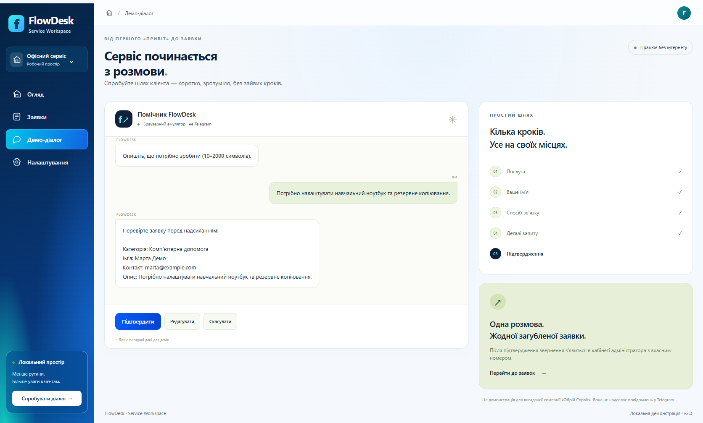
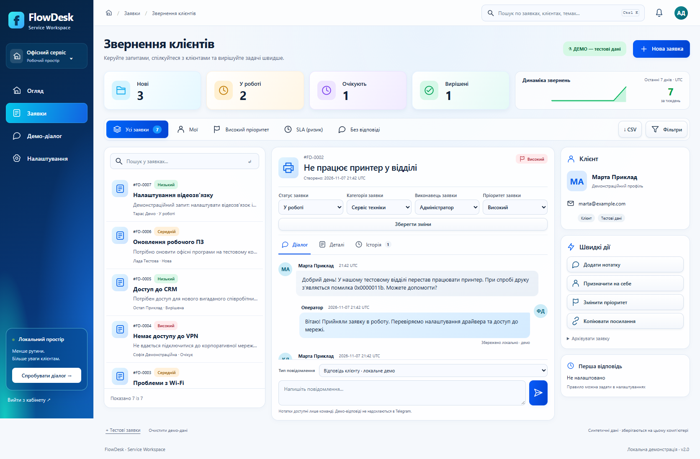
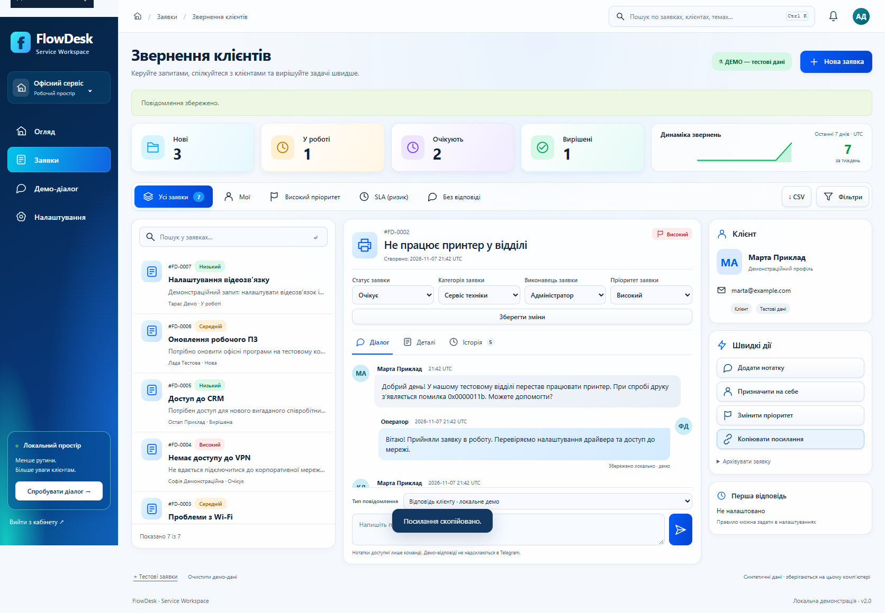

# FlowDesk Bot — учебный кейс

**Тип:** самостоятельный проект для портфолио. **Заказчик:** отсутствует; компания «Обрій Сервіс» и все примеры вымышлены. **Проверка:** 04.11.2026. **Публикация:** отсутствует, приложение локальное.

## Проблема и аудитория

Небольшой сервисной команде нужно превращать свободные сообщения в структурированные обращения: знать, кому помочь, как связаться и что уже сделано. В учебном кейсе показан этот процесс для компьютерной помощи, настройки сетей, сервиса техники и консультаций.

## Ограничения

Бюджет 0 грн, отсутствие Telegram-токена и оплаченного хостинга. Демо должно работать офлайн после установки. Только вымышленные данные. Украинский интерфейс, простой запуск Windows без глобального Python и без регистрации аккаунтов. Не использовать чужие дизайны, тексты и код.

## Решение

Создан браузерный эмулятор с тем же сценарием, что и необязательный Telegram-адаптер: категория, имя, проверяемый контакт, описание, проверка данных, изменение отдельного поля или отмена. Подтверждение создаёт запись в общей SQLite и выдаёт номер.

Администратор входит по локальной парольной фразе, работает с журналом и карточкой, меняет статус и заметки, ищет обращения и выгружает отфильтрованный CSV. Есть тестовые примеры и отдельное подтверждение удаления демо-данных. Серверные сессии, CSRF, хеширование пароля, транзакции и защита CSV включены в реализацию.

Визуальная система построена на спокойной светлой поверхности, тёмно-зелёной типографике и светлом зелёном акценте. Диалог и последовательность шагов стоят рядом на большом экране и переходят в одну колонку на телефоне. Все ресурсы локальные, базовые действия доступны без JavaScript.

Стек: Python, FastAPI, Jinja2, sqlite3, aiogram 3 (отдельный режим), pytest, Playwright, Ruff. Зависимости и Python устанавливаются в папку проекта.

## Как проверяли и что получили

- **41 pytest-тест — PASS:** весь путь заявки, валидация, редактирование и отмена, повторные и конкурентные подтверждения, ограничения частоты, сессии/CSRF, поиск, статусы, экспорт, защита HTML/CSV, перезапуск и сохранность данных.
- **Настоящий браузер Edge — PASS:** от ввода сообщения до редактирования заявки, выгрузки CSV, очистки и выхода. Внешние запросы приложения блокировались: попыток 0; ошибок JavaScript 0.
- **360 / 768 / 1440 px — PASS:** проверены диалог, журнал и карточка, сохранены скриншоты; переполнения всей страницы нет.
- **Ruff, compileall, pip check — PASS.** Реальная PowerShell-команда запуска и loopback-привязка проверены.

Подробности и честный список NOT TESTED: [QA.md](QA.md). Настоящий Telegram и уведомления не проверены без личного токена. Нет заявлений о коммерческих результатах, росте продаж, количестве клиентов или готовности к публичной эксплуатации.

## Скриншоты работающего приложения

Все изображения получены из реально запущенного приложения с вымышленными данными, а не из макета.

## Материал для отдельного сайта-портфолио

**Заголовок:** FlowDesk Bot — заявки от диалога до решения.

**Краткое описание:** «Навчальний сервіс для приймання звернень: офлайн-демо діалогу, захищений кабінет, статуси, нотатки та CSV. Python + FastAPI + SQLite; окремий адаптер Telegram. Перевірено 41 автоматичним тестом і браузерним сценарієм на трьох розмірах екрана».

**Подпись к демонстрации:** «Локальний навчальний проєкт. Реальне підключення Telegram потребує окремого налаштування й перевірки».

Материалы для загрузки на отдельный сайт:

| Материал | Локальный путь / ссылка |
|---|---|
| Обложка | `docs/screenshots/02-admin-desktop.png` |
| Диалог | `docs/screenshots/01-demo-desktop.png` |
| Карточка | `docs/screenshots/03-request-desktop.png` |
| Мобильная версия | `docs/screenshots/demo-360.png` |
| Полное описание | `portfolio-case.md` |
| Инструкция | `README.md` |
| Доказательства проверки | `QA.md` |
| Локальное демо после запуска | http://127.0.0.1:8000/demo |
| Локальный кабинет после запуска | http://127.0.0.1:8000/admin |
| Публичное демо / репозиторий | Не опубликованы; публичные ссылки отсутствуют |

Адрес localhost пригоден только на компьютере с запущенным проектом. Не ставьте его в публичную кнопку «Открыть демо». Для посетителей портфолио можно использовать скриншоты и описание до отдельного решения о публикации.

**Предлагаемая пометка:** «Локальне демо перевірено; Telegram — очікує налаштування». Это рекомендация для ручного решения владельца. Файлы отдельного сайта, включая `profile.js`, не менялись; `status: complete` не выставлялся.
